<picture>
  <source media="(prefers-color-scheme: dark)" srcset="assets/header-dark.svg">
  
</picture>

I've built software for 25 years, mostly backend systems: APIs, distributed services, data, and the cloud underneath. Today I work in EV charging, where reliability and clear system boundaries matter.

Find me at [luiz.dk](https://luiz.dk) or on [LinkedIn](https://www.linkedin.com/in/luizbenevenuto/).

### luiz.dk

My URL shortener and serverless playground: SvelteKit on Cloudflare (D1, KV, Durable Objects), Clerk auth, Drizzle. [Source](https://github.com/lbenevenuto/luiz-dk-sveltekit)

### Tools I use daily

TypeScript and Node.js (NestJS, Hono, AdonisJS), Go, PHP. PostgreSQL, MySQL. AWS, Google Cloud, Cloudflare, Docker. Svelte and Vue on the front end. Claude Code, Codex and Copilot in the editor.
